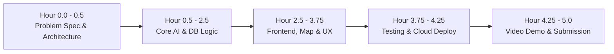
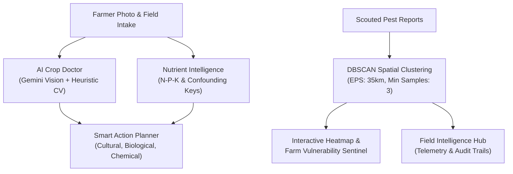

# DITE Hackathon 2026–27

## 1. Purpose & Workspace Overview
This repository serves as the official development workspace for our 3-member team (Bachelor of IT) competing in the **DITE Hackathon 2026–27** on **23 October 2026**.

* **Project Title:** **CropGuardian AI** — AI-Powered Crop Health, Nutrient Intelligence & Pest Outbreak Prediction
* **Theme:** Agriculture
* **Team Size:** 3 members
* **Development Window:** Strictly 5 hours
* **Target Objective:** Design, build, test, and publicly deploy an AI-powered agricultural intelligence application addressing crop pathology, soil nutrient diagnostics, and geospatial pest swarm surveillance.
* **Workspace Status:** Active development workspace (`D:\DITE_HACKATHON`).

---

## 2. Hackathon Requirements & Constraints

| Requirement | Specification | Verification Method |
| :--- | :--- | :--- |
| **Development Time** | Strictly 5 hours | Commit timestamps during the event window |
| **Original Work** | All application code authored during the hackathon | Git commit history from initialization to final push |
| **Deliverable** | Working AI-powered web app | Public HTTPS URL on Streamlit Community Cloud |
| **Repository** | Mandatory public GitHub repository | [https://github.com/Muzamil852/DITE_HACKATHON_2026](https://github.com/Muzamil852/DITE_HACKATHON_2026) |
| **Documentation** | Mandatory `README.md` with architecture & setup | Detailed in this file |
| **Demonstration** | 3–5 minute video demo uploaded to Google Drive | Link with permissions set to "Anyone with link can view" |
| **Submission** | All links submitted before cutoff | Hackathon portal / organizer submission form |

---

## 3. Current Preparation & Build Status

> [!NOTE]
> All statuses below reflect verified system checks and tests performed on 23 October 2026.

* [x] **Workspace Inspection:** Clean, dedicated workspace with no legacy code contamination.
* [x] **Git Tooling & Remote:** Git 2.55.0 verified; linked to GitHub (`Muzamil852/DITE_HACKATHON_2026`).
* [x] **Runtime Environments:** Python 3.14.4 & pip 26.0.1; Streamlit 1.61.1, Scikit-Learn 1.9.0, Plotly 6.9.0.
* [x] **Security Shield:** `.gitignore` active (ignoring `.env`, secrets, `.db`, `venv/`, and `node_modules`).
* [x] **Theme Announced:** Agriculture (CropGuardian AI).
* [x] **AI Diagnostic Engine Built:** Dual-mode Google Gemini Vision API + Offline Agronomic Heuristic CV.
* [x] **Nutrient Intelligence Module Built:** Mobile/immobile translocation mapping with mandatory soil test disclaimers.
* [x] **Geospatial Pest Heatmap Built:** DBSCAN clustering, threat buffers, and farm proximity vulnerability sentinel.
* [x] **Smart Action Planner Built:** 4-tier calibrated IPM interventions (cultural, biological, chemical safety, verification).
* [x] **Field Intelligence Hub Built:** Real-time telemetry, simulated vs live data auditing, and CSV export.

---

## 4. Development Workflow (5-Hour Execution Plan)



### Team Role Allocation (3 Members)
* **Member 1 (Lead & AI Engineering):** Antigravity AI pair programming, Gemini Vision prompt engineering, agronomic fallback heuristics, and backend pipelines.
* **Member 2 (Frontend & UI/UX):** Streamlit UI engineering, custom agricultural styling, Plotly geospatial map integration, and responsive layout.
* **Member 3 (QA, Deployment & Video Production):** Environment secrets, testing edge cases, Streamlit Cloud deployment verification, 3–5 min demo recording, and Google Drive submission.

---

## 5. Security & Privacy Safeguards

> [!CAUTION]
> The GitHub repository is public. Never commit credentials, private tokens, or connection strings.

- [x] `.gitignore` active and preventing `.env` or `*.db` commits.
- [x] `.env.example` provided with safe placeholder variables.
- [x] In-app password masked input for optional API keys (kept in memory/session state only).
- [x] **Farmer GPS Privacy:** Precise user coordinates are never published publicly; community alerts are strictly aggregated via regional DBSCAN cluster buffers.
- [x] **Scientific Integrity:** Strictly labels simulated demonstration reports; never presents mock data as genuine farmer observations.

---

## 6. CropGuardian AI — Application Architecture & Pillars



### 6.1 The Five Core Capabilities
1. **AI Crop Doctor:**
   * Multimodal disease detection from leaf photographs.
   * Cites specific visual markers (chlorosis ratios, target rings, necrotic margins).
   * Fully discloses uncertainty and alternative pathogen/abiotic hypotheses.
   * Dual-mode architecture: **Google Gemini 1.5 Flash Vision** with automatic failover to local **Agronomic Heuristic Computer Vision Engine**.

2. **Nutrient Intelligence:**
   * In-depth diagnostic profiles for N, P, K, Mg, Fe, Zn, and Ca.
   * Visual keys for mobile (older foliage) vs immobile (younger foliage) nutrient transport.
   * Evaluates confounding factors: root-rot hypoxia, overwatering, salinity scorch, and soil pH locks.
   * **Mandatory Agronomic Disclaimer:** Always enforces soil EC/pH or petiole sap testing before fertilizer application.

3. **Pest Outbreak Heatmap & Cluster Sentinel:**
   * Spatial clustering using **Scikit-Learn DBSCAN** (`eps=35km`, `min_samples=3`) to detect active infestation epicenters.
   * High-contrast interactive map (Plotly Mapbox) with color-coded threat zones (Critical Red, High Orange, Moderate Amber).
   * **Farm Vulnerability Sentinel:** Computes real-time proximity from the user's farm to active outbreak centers and issues emergency response actions.

4. **Smart Action Planner:**
   * Multi-tier evidence-based interventions:
     * *Tier 1: Cultural & Mechanical Sanitation* (canopy pruning, drip irrigation switch, debris removal).
     * *Tier 2: Biological & Bio-Rational Controls* (cold-pressed neem oil 0.5%, *Bacillus subtilis*, pheromone traps).
     * *Tier 3: Responsible Chemical Safety* (economic threshold enforcement, PPE requirements, pollinator protection hours, Pre-Harvest Intervals).
     * *Tier 4: Verification & Diagnostic Audit* (48-hour scouting checklists and diagnostic clinic validation).

5. **Field Intelligence Hub:**
   * Surveillance telemetry breaking down pest species frequency and crop vulnerability.
   * **Data Transparency:** Strictly separates **Verified Farmer Field Reports** from **Simulated Demonstration Baseline Reports**.
   * One-click CSV export for agricultural extension officers and researchers.

---

## 7. Local Setup & Execution Guide

```bash
# 1. Clone repository
git clone https://github.com/Muzamil852/DITE_HACKATHON_2026.git
cd DITE_HACKATHON_2026

# 2. Install dependencies
pip install -r requirements.txt

# 3. (Optional) Configure Gemini API Key
# Copy .env.example to .env and insert your GEMINI_API_KEY
# If omitted, the app operates automatically via the offline Agronomic Heuristic Engine!

# 4. Launch Application
streamlit run app.py
```

---

## 8. Final Submission Checklist

* [x] **Public GitHub Repository:** [https://github.com/Muzamil852/DITE_HACKATHON_2026](https://github.com/Muzamil852/DITE_HACKATHON_2026) *(Verified Active & Synced)*
* [ ] **Live Public Application URL:** `[To be populated upon Streamlit Community Cloud launch]`
* [ ] **Demo Video URL (3–5 min, Google Drive):** `[Pending Recording & Upload]`
  * Sharing settings: **"Anyone with the link can view"** (tested in incognito)
* [ ] **Submission Form:** Completed and confirmed prior to the 5-hour deadline.

---

## 9. Hackathon Team & Acknowledgments
* **Team:** Bachelor of IT (3 Members)
* **Hackathon:** DITE Hackathon 2026–27 (23 October 2026)
* **Theme:** Agriculture
