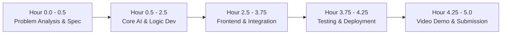

# DITE Hackathon 2026–27

## 1. Purpose & Workspace Overview
This repository serves as the official preparation and development workspace for our 3-member team (Bachelor of IT) competing in the **DITE Hackathon 2026–27** on **23 October 2026**.

* **Team Size:** 3 members
* **Development Window:** 5 hours
* **Target Objective:** Design, build, test, and publicly deploy an AI-powered web application (or distribute an installable APK for mobile) addressing the challenge announced on event day.
* **Workspace Status:** Active preparation workspace (`d:\DITE_HACKATHON`).

---

## 2. Hackathon Requirements & Constraints

| Requirement | Specification | Verification Method |
| :--- | :--- | :--- |
| **Development Time** | Strictly 5 hours | Commit timestamps during the event window |
| **Original Work** | All application code authored during the hackathon | Git commit history from initialization to final push |
| **Deliverable** | Working AI-powered web app or mobile APK | Public HTTPS URL or installable `.apk` file |
| **Repository** | Mandatory public GitHub repository | Accessible public URL with README |
| **Documentation** | Mandatory `README.md` with architecture & setup | Evaluated by judges in repository root |
| **Demonstration** | 3–5 minute video demo uploaded to Google Drive | Link with permissions set to "Anyone with link can view" |
| **Submission** | All links submitted before cutoff | Hackathon portal / organizer submission form |

---

## 3. Current Preparation Status

> [!NOTE]
> All statuses below reflect verified system checks performed on 22 October 2026.

* [x] **Workspace Inspection:** Verified clean directory (`d:\DITE_HACKATHON`) without conflicting legacy files.
* [x] **Git Tooling:** Git 2.55.0 verified installed. Global config: `Muzamil852` (`ahmedmuzamil180@gmail.com`).
* [x] **Runtime Environments:**
  * Python 3.14.4 & pip 26.0.1 available.
  * Node.js v25.1.0 & npm 11.6.2 available (`npm.cmd`).
* [x] **Mandatory README:** Prepared with architectural blueprints, testing criteria, and submission protocols.
* [ ] **Local Git Repository:** Pending initialization (`git init -b main`).
* [ ] **Git Ignore Configuration:** Pending `.gitignore` creation to prevent credential leaks.
* [ ] **GitHub Remote Connection:** Pending repository creation on GitHub (`dite-hackathon-2026`) and remote linking.
* [ ] **Problem Announcement:** Scheduled for 23 October 2026.

---

## 4. Development Workflow (5-Hour Execution Plan)

Given the tight 5-hour constraint, the team operates in structured time blocks:



### Team Role Allocation (3 Members)
* **Member 1 (Lead & AI Engineering):** Antigravity AI pair programming, prompt engineering / model API integration, backend pipelines, and business logic.
* **Member 2 (Frontend & UI/UX):** User interface design (Streamlit components or React/Vite UI), user workflows, visual responsiveness, and input forms.
* **Member 3 (QA, Deployment & Video Production):** Environment variables, hosting configuration (Cloud / Netlify / Render), testing edge cases, recording the 3–5 minute demo video, and Google Drive upload.

---

## 5. Git & GitHub Workflow

### Branching & Commit Discipline
* **Default Branch:** `main` (always in a deployable, tested state).
* **Feature Branches (if parallelized):** `feat/<feature-name>`, merged via pull request or rebase after verification.
* **Commit Conventions:**
  * `feat:` New features or functional endpoints.
  * `fix:` Bug fixes or corrections.
  * `docs:` Documentation or README updates.
  * `style:` Layout, formatting, or styling improvements.
  * `refactor:` Code reorganization without behavioral change.

### Repository Setup Commands
```bash
# 1. Initialize local repository
git init -b main

# 2. Add files and make initial commit
git add README.md .gitignore
git commit -m "docs: initialize hackathon workspace with preparation guide"

# 3. Connect to GitHub remote
git remote add origin https://github.com/Muzamil852/dite-hackathon-2026.git

# 4. Push to public GitHub
git push -u origin main
```

---

## 6. AI-Assisted Development Workflow with Antigravity

Antigravity functions as the team's autonomous technical accelerator:
1. **Rapid Scaffolding:** Generate project structure, dependency files (`requirements.txt`, `package.json`), and boilerplate.
2. **AI API Integration:** Implement robust error-handled client calls to LLMs (Gemini, Claude, or OpenAI) with exponential backoff and timeout handling.
3. **Refactoring & Debugging:** Identify syntax errors, hydration issues, and asynchronous race conditions.
4. **Live Verification:** Run local servers, execute unit tests, and inspect build outputs directly before commits.

---

## 7. Deployment Strategy & Candidate Architectures

The architectural route will be chosen within the first 30 minutes based on problem requirements:

| Architecture | Tech Stack | Ideal Use Case | Hosting Platform |
| :--- | :--- | :--- | :--- |
| **Option A (Fastest)** | Python + Streamlit | Data-heavy, analytical, or rapid conversational AI tools | **Streamlit Community Cloud** (instant deploy from GitHub) |
| **Option B (Modern Web)** | React + Vite (Frontend) + FastAPI (Backend) | Rich interactive web apps, custom UI components, high responsiveness | **Netlify** (Frontend) + **Render** (API Backend) |
| **Option C (Data-Backed)** | Next.js or React + Supabase (PostgreSQL) | Apps requiring multi-user persistence, auth, or vector similarity | **Netlify / Vercel** + **Supabase Cloud** |
| **Option D (Mobile)** | Flutter / React Native / PWA | Mobile-first requirement with downloadable `.apk` | **GitHub Releases** for APK download |

---

## 8. Testing Checklist

Before initiating deployment:
- [ ] **Functional AI Execution:** Prompts produce expected schema/JSON without runtime exceptions.
- [ ] **Input Validation:** Gracefully handles empty inputs, special characters, and excessively long text.
- [ ] **API Failover:** Meaningful user-facing error message displayed when AI rate limits or network issues occur.
- [ ] **Build Integrity:** Local production build (`npm run build` or clean Python execution) passes with zero errors.
- [ ] **Mobile & Responsive Viewport:** Interface renders legibly on smartphone screens (tested via browser devtools).

---

## 9. Security Checklist

> [!CAUTION]
> The GitHub repository is public. Never commit credentials, private tokens, or connection strings.

- [ ] `.gitignore` is populated and active before any git commit.
- [ ] All API keys stored in local `.env` file (never pushed).
- [ ] `.env.example` provided with placeholder values for evaluators.
- [ ] Cloud platforms configured with secrets via their web dashboards (e.g. Streamlit Secrets, Netlify Environment Variables).
- [ ] Pre-push inspection completed (`git status` and `git diff --cached` verified free of secrets).

---

## 10. Public-Access & Deployment Verification

Once deployed:
- [ ] Accessible over public HTTPS.
- [ ] Verified loading in an **Incognito / Private browser window** (confirms no local cache/cookie dependency).
- [ ] Verified loading from an external network (e.g. mobile cellular data).
- [ ] Cold start and response latency evaluated.

---

## 11. Final Submission Checklist

* [ ] **Public GitHub Repository:** [https://github.com/Muzamil852/dite-hackathon-2026](https://github.com/Muzamil852/dite-hackathon-2026) *(pending creation)*
* [ ] **Live Public Application URL / APK:** `[Pending Deployment on Event Day]`
* [ ] **Demo Video URL (3–5 min, Google Drive):** `[Pending Recording & Upload]`
  * Sharing settings: **"Anyone with the link can view"** (tested in incognito)
* [ ] **Submission Form:** Completed and confirmed prior to the 5-hour deadline.

---

## 12. Post-Announcement Application Documentation
*(This section will be populated on 23 October 2026 once the hackathon problem statement is announced.)*

### 12.1 Problem Statement & Selected Challenge
*To be filled upon reveal.*

### 12.2 Solution Overview & Core Features
*To be filled upon reveal.*

### 12.3 System Architecture
*To be filled upon reveal.*

### 12.4 Local Setup & Installation
```bash
# Clone the repository
git clone https://github.com/Muzamil852/dite-hackathon-2026.git
cd dite-hackathon-2026

# Follow instructions based on chosen stack:
# Python: pip install -r requirements.txt && streamlit run app.py
# Node: npm install && npm run dev
```

### 12.5 Hackathon Team & Acknowledgments
* **Team:** Bachelor of IT, 3 Members
* **Hackathon:** DITE Hackathon 2026–27 (23 October 2026)
